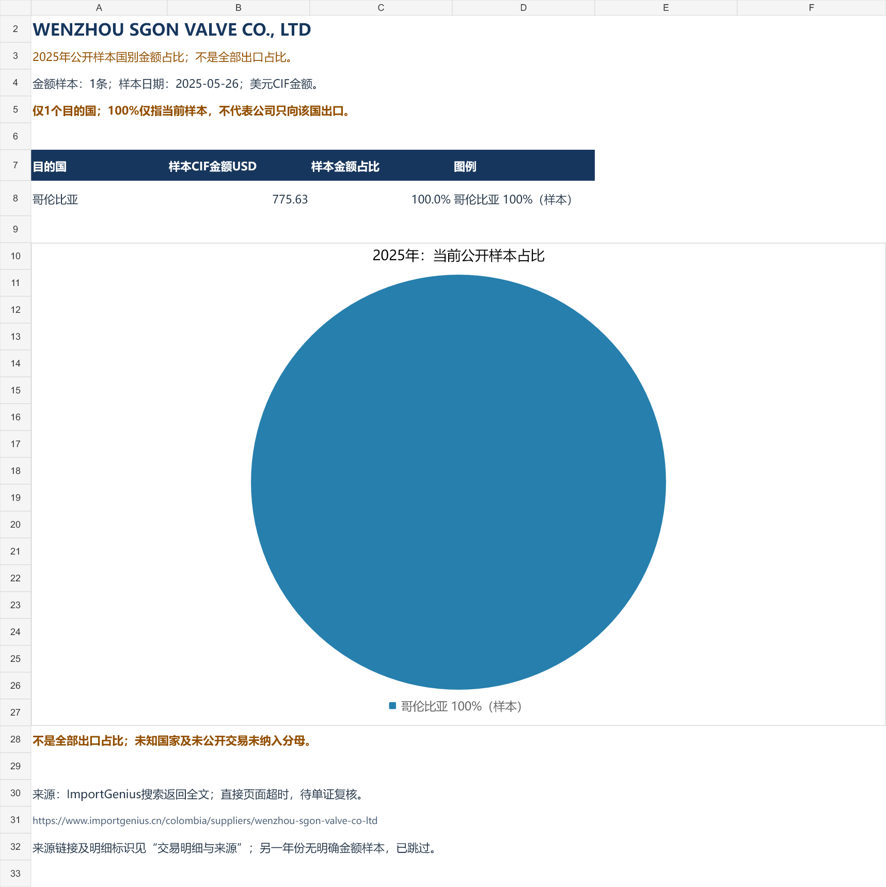

# 阀门市场重点信息看板

## 2025及2026企业公开样本饼图

[下载可编辑饼图及交易来源 Excel](./阀门企业_2025及2026公开样本占比饼图.xlsx)

按同一供应商、同一年已收集的美元CIF阀门交易明细金额计算国别占比。**不是全部出口占比。**本次纳入3条金额样本，生成2025年2张、2026年1张独立饼图；其他没有明确可比金额的公司期间组合跳过。

| 公司/供应商 | 年份 | 金额样本日期 | 样本CIF美元 | 国别样本占比 | 独立图片 |
| --- | --- | --- | ---: | --- | --- |
| 天津银河阀门有限公司 | 2025 | 2025-07-31 | 8,930.00 | 哥伦比亚100% | [查看](./sample-charts/2025_天津银河_样本饼图.png) |
| WENZHOU SGON VALVE CO., LTD | 2025 | 2025-05-26 | 775.63 | 哥伦比亚100% | [查看](./sample-charts/2025_SGON_样本饼图.png) |
| 公元管道（浙江）有限公司 | 2026 | 2026-03-09 | 8,477.13 | 哥伦比亚100% | [查看](./sample-charts/2026_公元管道_样本饼图.png) |

每家公司当前只有1条明确金额样本、1个目的国，所以图中100%仅说明哥伦比亚占已收集金额样本的全部，不代表企业只出口该国。2026图仅包含3月9日的当前样本，不代表1月至10月的完整覆盖。公元和SGON来自仓库交易线索，未与487条企业名录强制合并；SGON保留英文供应商名称，中文法人未核验。

天津银河金额为平台CIF展示取整值；ImportGenius两条通过搜索返回全文复核，直接页面超时，仍待完整单证核验。来源：[天津银河Panjiva样本](https://cn.panjiva.com/Tianjin-Galaxy-Valve-Co-Ltd/97562203)、[SGON ImportGenius样本](https://www.importgenius.cn/colombia/suppliers/wenzhou-sgon-valve-co-ltd)、[公元/EAGER ImportGenius样本](https://www.importgenius.cn/colombia/importers/eagers-a-s)。

 

## 企业完整出口国别占比核查（全量制图尚未完成）

[下载2025及2026出口国别核查表](./阀门企业出口国别核查_2025及2026.xlsx)

截至2026年10月14日，原名单487条记录均参与了公司名称与2025/2026、出口、国家、金额关键词初筛。部分年报及交易样本另行复核；候选页面未逐页核验，关键词初筛不代表穷尽全网资料。原名单包含历史名称和门店记录，不能直接视为487家独立法人。

本次没有取得满足“同一企业、同一期间、各目的国阀门出口金额及全部出口金额”口径的完整数据，因此尚未生成各公司2025全年及2026年至今的国别占比饼图。核查表保留每条记录的两个期间状态、检索词、候选来源、部分已复核资料和缺失字段；另列仓库既有59条公开交易线索。

已复核资料中，纽威2025年报的地区收入表只区分内销/外销，万得凯2025年报只区分境内/境外；万得凯2026半年报第135页为母公司境外收入，不能当作集团出口总额或截至10月的累计数据。银河阀门公开哥伦比亚样本也不能当作全年出口，或画成该国占100%。未取得金额保持缺失，不当作零值。全部限制及来源见工作簿。

## 中国阀门企业及销售商名单

[下载企业名单 Excel](./中国阀门企业名单_2026-10-14.xlsx)

截至2026年10月14日整理，工作簿包含487条阀门企业及销售商记录，覆盖中国大陆及港澳台的制造、贸易、代理和相关服务企业；另列298条产业链关联企业供筛选。可按地区、企业类型和核实状态筛选，每条记录附公开资料来源。

这是一份公开资料汇编，不是全国全量工商名册。制造能力、工商存续、历史名称与集团子公司关系未逐户核验；缺失字段及不确定信息已标注。协会历史名录和展会目录的覆盖缺口见工作簿“范围与核实说明”。

2025年至2026年阀门贸易数据的中文看板。HS 8481包含阀门、水龙头及零件。

## 文件

- `index.html`：交互版，支持选择国家、查看月度增速、搜索和排序41个可比市场。
- `阀门月度数据_清晰版.xlsx`：原始月度工作簿、英国阀型细分及来源与覆盖说明。

## 打开与分享

下载HTML后用Chrome、Edge或Safari打开。微信文件预览可能限制JavaScript，交互版应选择“用浏览器打开”。

若要通过网址访问，在仓库 Settings → Pages 中选择 Deploy from a branch，分支 `main`，目录 `/ (root)`，保存后等待部署完成。页面入口为 `index.html`。仓库文件页面本身不会运行HTML。

## 数据范围

- 市场对比为2026年1—7月与2025年同期，仅纳入两年7个月均齐全的41个市场。
- 市场金额为美元，英国细分阀型金额为英镑。同比在同一币种内计算。
- UN Comtrade进口方报告的自中国进口是镜像数据，不等同于中国报告的出口。
- 国家覆盖及最新月份存在缺报；缺失未作为零值，样本结果不代表完整全球需求。
- 进口金额受价格、数量、产品组合和汇率影响，不直接代表采购数量。
- 英国细分来自HMRC UK Trade Info，不能视为所有国家的阀型趋势，也不是工厂型号。
- 文件整理日期：2026年10月14日；本次上传未刷新基础数据。

来源：[UN Comtrade](https://comtradeplus.un.org/)、[HMRC数据说明](https://www.uktradeinfo.com/api-documentation)。原始数据及覆盖说明见工作簿。

## 中国供应商公开记录

新增目的国与年份选择、公司—买家证据表，以及有金额样本的公司构成饼图。

- `company-evidence.json` / `company-evidence.csv` 保存本次公开研究的59条商品明细、31个供应商名称及来源。
- 记录涉及美国、哥伦比亚、印度、厄瓜多尔、越南、孟加拉国、巴基斯坦、墨西哥、乌克兰和菲律宾；核查程度逐条显示。
- 哥伦比亚饼图仅涵盖3条可见CIF金额明细（2025年2条，2026年1条），绝不是全国公司市场份额。
- 检索全文可见但直接页面失败的记录明确标记为待复核；未披露金额不是零值。
- 厄瓜多尔线索没有确认该笔HS编码，因此不纳入阀门金额计算。
- 存在页面与搜索结果差异、最终目的国不明的线索不纳入金额图。
- 所有已获取公司单独列出，不合并“其他”；没有取得的公司无法由当前样本穷举。

完整国家金额份额尚未取得。Panjiva等完整明细需要订阅或授权数据访问，本次仅获取公开页面，未购买或访问付费明细。

## 第二轮补充及口径

截至2026年10月14日，公开库累计59条商品明细、31个供应商名称、10个目的国。供应商名称数不等于已完成工商主体核验的公司数量。可按国家、年份和月份筛选；原页面未注明币种及CIF/FOB的金额保存在reported_amount，value_usd留空，不进入美元饼图。

明确CIF美元的记录只有3条，且仍为不完整公开样本。搜集范围包括阀门与零件、灭火器阀和内胎气门嘴；不能统一当作工业管道阀门。制造商和出口贸易商分开保存。外贸邦IDEAL页头国家与交易行目的国不一致，WUZHOU页头地址异常，相关记录保留并标注待核。完整覆盖与全国公司份额仍未取得。
